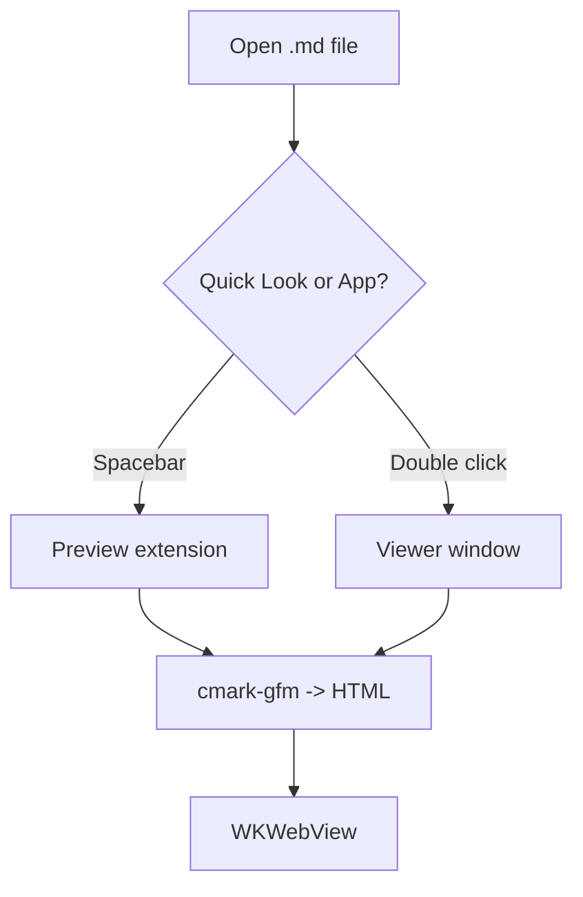
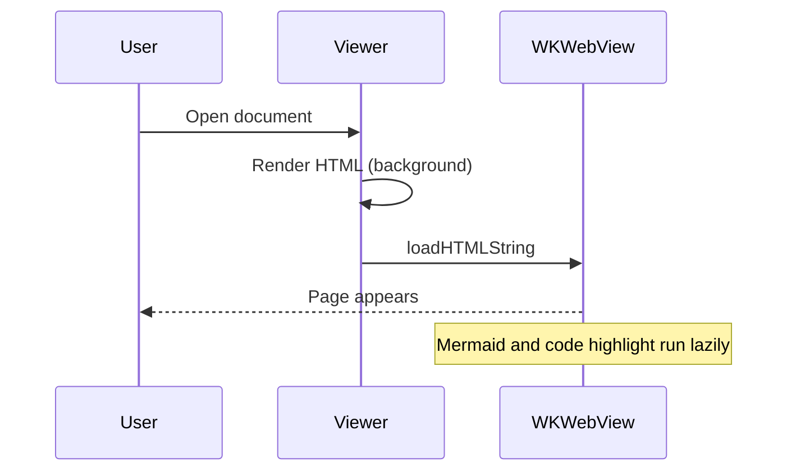

# Markdown Viewer Showcase

A tour of everything the viewer renders. Jump to [Code](#code-blocks), [Mermaid](#mermaid-diagrams) or the [footnotes](#footnotes).

## Text styles

Plain, *emphasis*, **strong**, ***both***, ~~strikethrough~~, `inline code`, and a hard
break right here:  
next line. Autolinks: https://example.com and www.example.org and <https://github.com>.

> Blockquotes work.
>
> > And nest.

---

## Lists

- Item one
  - Nested item
    - Deeper
- Item two

1. First
2. Second
   1. Sub-step
3. Third

### Task lists

- [x] Parse GFM with cmark-gfm
- [x] Render Mermaid lazily
- [ ] World domination
  - [x] Nested done
  - [ ] Nested todo

## Tables

| Left aligned | Centered | Right aligned |
|:-------------|:--------:|--------------:|
| `a`          | b        | 1             |
| longer cell  | **bold** | 22            |
| ~~old~~      | [link](https://example.com) | 333 |

## Code blocks

```swift
struct Greeter {
    let name: String
    func greet() -> String { "Hello, \(name)!" }
}
print(Greeter(name: "world").greet())
```

```python
from dataclasses import dataclass

@dataclass
class Point:
    x: float
    y: float

    def norm(self) -> float:
        return (self.x ** 2 + self.y ** 2) ** 0.5
```

```javascript
const sleep = (ms) => new Promise((r) => setTimeout(r, ms));
async function main() {
  for (const n of [1, 2, 3]) { await sleep(10); console.log(n); }
}
main();
```

```rust
fn fib(n: u32) -> u64 {
    match n { 0 => 0, 1 => 1, _ => fib(n - 1) + fib(n - 2) }
}
```

```go
package main

import "fmt"

func main() { fmt.Println("hello") }
```

```bash
#!/usr/bin/env bash
set -euo pipefail
for f in *.md; do echo "$f"; done
```

```json
{ "name": "markdown-viewer", "version": "1.0.0", "private": true, "tags": ["md", "gfm"] }
```

```yaml
services:
  web:
    image: nginx:latest
    ports: ["8080:80"]
```

```sql
SELECT u.name, COUNT(*) AS posts
FROM users u JOIN posts p ON p.user_id = u.id
GROUP BY u.name HAVING COUNT(*) > 3;
```

```diff
- old line
+ new line
```

```html
<div class="card"><h1 id="x">Hi</h1></div>
```

```
A fenced block with no language is left alone.
```

## Mermaid diagrams





A deliberately broken diagram shows the error fallback:

```mermaid
graph TD
    A --> --> B
```

## Raw HTML

<details>
<summary>Click to expand</summary>

Hidden content with **markdown** inside.

</details>

Line<br>break and <kbd>Cmd</kbd>+<kbd>R</kbd> keys. The following is neutralised by the tagfilter:

<script>alert("should never run")</script>

## Footnotes

Here is a footnote reference[^1] and another[^note].

[^1]: The first footnote.
[^note]: A longer note with `code` and a [link](https://example.com).

## Headings with anchors

### Repeated heading

### Repeated heading

See [Repeated heading](#repeated-heading-1) and [top](#markdown-viewer-showcase).

#### Fourth level
##### Fifth level
###### Sixth level
